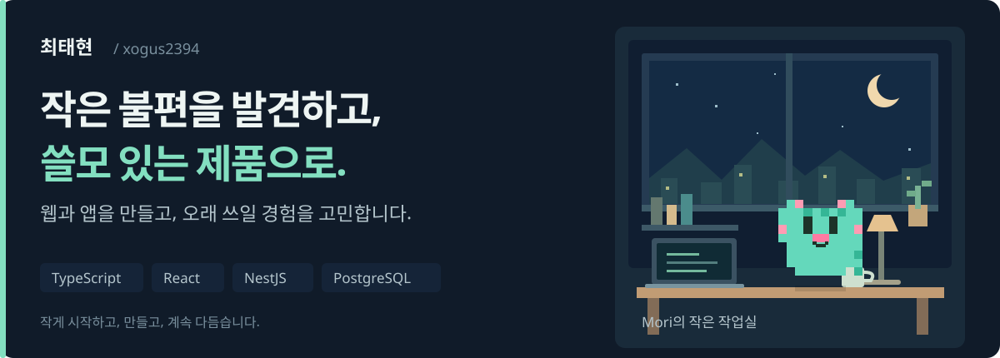
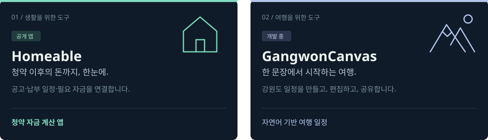
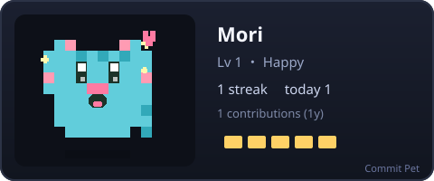
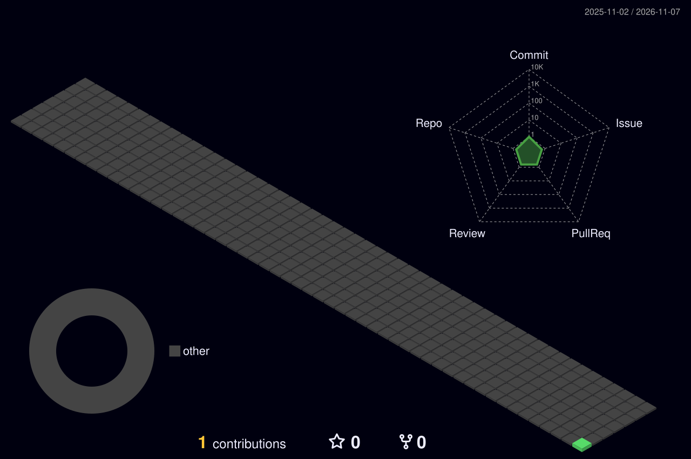

<picture>
  <source media="(max-width: 640px)" srcset="./assets/studio-mobile.svg">
  
</picture>

### 만드는 서비스

<picture>
  <source media="(max-width: 640px)" srcset="./assets/projects-mobile.svg">
  
</picture>

[홈어블 Google Play](https://play.google.com/store/apps/details?id=com.teamhomeable.app) · [홈어블 웹사이트](https://homeable.co.kr/)

<strong>고양이 상태와 3D 잔디 펼쳐보기</strong>

공개 활동을 기준으로 매일 갱신합니다. 비공개 활동 공개 설정은 변경하지 않았습니다.

그림 생성: [Commit Pet](https://github.com/yukurash/commit-pet) · [3D Contrib](https://github.com/yoshi389111/github-profile-3d-contrib)

프로젝트 소스 코드는 비공개로 관리합니다.
